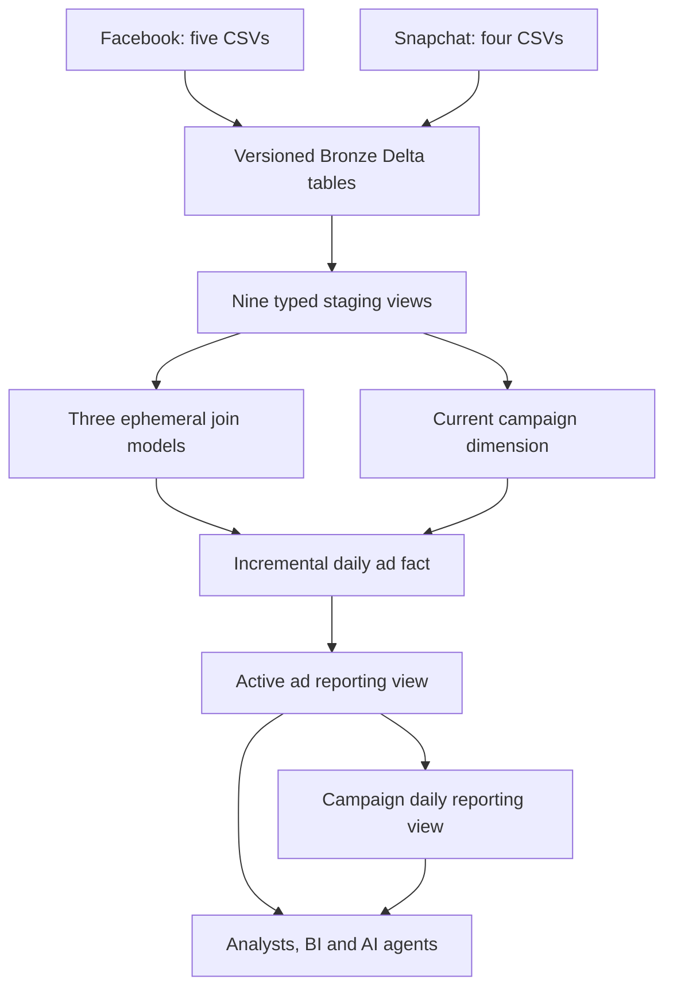

# Marketing Data Platform — Databricks + dbt

A source-specific implementation for the nine supplied Facebook and Snapchat CSVs. It ingests complete extracts into versioned Delta Bronze tables, standardizes them in dbt, and exposes governed daily ad and campaign reporting with explicit metric completeness.

**Start with [START_HERE.md](START_HERE.md).** The code is prepared for Databricks; workspace deployment and live execution are still required. Local checks execute the model SQL semantically in SQLite with a restricted renderer, not the dbt/Spark adapters. The supplied validation JSON records exactly what was tested. No live dbt documentation or Elementary report is claimed as generated.

## What is included

- A Unity Catalog ingestion notebook for all nine actual file schemas, with immutable batch IDs, SHA-256 file/row metadata, row-count auditing, idempotent batch replacement and atomic publication of complete raw batches.
- Nine staging views, three reusable ephemeral intermediate models, a current campaign dimension, a Delta incremental fact, an active ad-level reporting view and a campaign/day reporting view.
- dbt key, accepted-value, referential, metric, version-conflict, fanout, null-safe-rate, source-label and reconciliation tests.
- Elementary package and CLI profiles; separate development, staging, CI and production targets; service-principal OAuth for noninteractive execution.
- GitHub Actions for offline checks, dbt parsing, isolated PR builds, staging and production; configuration-driven Unity Catalog grants and analyst view access.
- A source profile, linked fixtures, data dictionary, business queries, architecture decisions and deployment checklist.

## Architecture



The published raw batch is frozen by `scripts/run_dbt.py`; every staging model and raw test reads that same batch. Bronze is appendable by batch, staging contains typing and current-record selection, intermediate models normalize platform joins, and marts expose documented analytical contracts.

## Exact source mapping

| Source file | Bronze logical source | Important relationship |
|---|---|---|
| ads_stats.csv | facebook_stats | account_id + ad_id to ads |
| new_ads_de_randomized.csv | facebook_ads | campaign_id, ad_group_id, account_id |
| new_adgroup_de_randomized.csv | facebook_adgroups | ad_group_id |
| new_campaign_de_randomized.csv | facebook_campaigns | campaign_id |
| new_acccount_de_randomized.csv | facebook_accounts | account_id provides currency |
| snapchat_ads_stats.csv | snapchat_stats | ad_detail_id maps to ads.ad_id |
| snapchat_ads_ad_history_new_ad_names.csv | snapchat_ads | ad_group_id |
| snapchat_ads_adgroup_history_new_ad_group_names.csv | snapchat_adgroups | campaign_id; multiple versions exist |
| snapchat_ads_campaign_history_new_campaign_names.csv | snapchat_campaigns | account_id |

Identifiers are strings. In particular, Facebook's long numeric IDs must never be converted to floating point. Platform is determined by the source, never inferred from randomized campaign names. The existing Snapchat `_surrogate_key` is retained in Bronze but is not trusted as the analytical primary key.

## Grain and keys

`fct_marketing_spend` has one row per **platform, account, ad, reporting day, country, currency**. Facebook does not provide country, so its country_code is null. Snapchat country comes from the statistics export. Country must remain in the fact key to avoid collapsing different country slices. The campaign reporting view aggregates country away and has one row per platform/account/campaign/day/currency.

`performance_key` is an MD5 surrogate over length-prefixed source identifiers, date, country and currency. Null and empty string have distinct encodings. This protects against delimiter collisions; MD5 is used for compact analytical keys, not security. Natural-grain tests remain the actual integrity check. `campaign_key` includes platform/account/campaign. Join on IDs, not names.

## Metric contract

| Field | Definition and null behavior |
|---|---|
| spend | Decimal(20,6) source monetary amount; currency_code is mandatory |
| impressions | Nullable observed count; null is unknown |
| clicks | Nullable source click count; null is unknown |
| ctr | clicks / impressions as a fraction; null for unknown clicks or unknown/zero impressions |
| cpc | spend / clicks; null for unknown/zero clicks |
| cpm | spend / impressions × 1,000; null for unknown/zero impressions |
| known_clicks / known_impressions | Sums of available counts; may be incomplete |
| unknown_*_rows | Number of contributing rows with unavailable metrics |

Campaign-level clicks/impressions become null if any contributing observation is unknown. Campaign rates use complete aggregated numerators/denominators. Never average row-level CTR/CPC/CPM. For a higher-level report, aggregate source metrics with the same completeness rules before dividing. Spend remains usable when clicks or impressions are incomplete.

**Keep spend separated by currency.** No FX table was supplied, so no conversion is invented. Snapchat spend is already decimal in the provided export; applying the API microcurrency conversion again would understate it. Click definitions can differ by platform; use the source click metric without claiming equivalent conversion intent.

## Findings in the supplied full data

| Platform | Currency | Stat rows | Spend | Known impressions | Missing impression rows | Known clicks | Missing click rows |
|---|---|---:|---:|---:|---:|---:|---:|
| Facebook | EUR | 26,088 | 2,562,561.240000 | 295,373,593 | 1,245 | 1,158,683 | 6,452 |
| Facebook | USD | 66,212 | 6,869,536.990000 | 610,075,828 | 229 | 4,579,027 | 17,885 |
| Snapchat | EUR | 2,809 | 30,529.544764 | 33,395,784 | 0 | 19,012 | 111 |

The original extracts contain 214,535 records across nine files, including 95,109 daily metric rows. No exact duplicate input rows or duplicate metric business keys were observed. Three Snapchat ad groups have two versions each; reduce history before joining. No statistics-to-ad orphans were observed. Additional parent relationships are checked in the full local SQL validation.

Facebook dates span **2025-01-01–2025-12-31**; Snapchat dates span **2024-01-01–2024-12-02**. These are different periods. Do not present the totals as a like-for-like platform performance comparison, and do not treat randomized name date fragments as event dates.

## Materializations and changes

| Layer/model | Materialization | Reason |
|---|---|---|
| Bronze | Delta tables, partitioned by batch | Retain complete snapshots, audit and replay |
| Staging | Views | Keep source cleaning simple and observable |
| Intermediate | Ephemeral | Reuse joins without maintaining extra tables |
| dim_campaigns | Delta table | Small current dimension, rebuilt each run |
| fct_marketing_spend | Incremental Delta MERGE | Atomic keyed upsert; historical corrections and deletion tombstones |
| Reporting | Views | Central metric definitions and active-row filtering |

This dataset is small. The fact deliberately scans the entire pinned raw snapshot, including old dates, rather than using a fragile maximum-date watermark. It merges current keys and adds `is_deleted=true` rows for keys absent from the replacement snapshot. Deleted observations remain in the fact for audit, but both reporting views exclude them. Historical dimension changes use Type 1 attribution: today's available name/parent mapping applies to all reporting dates. The extracts lack the consistent validity intervals needed for trustworthy point-in-time SCD2 attribution.

Exact duplicate source payloads collapse in staging. Conflicting rows at the statistics grain cause a failing test; they are never summed or arbitrarily picked. Conflicting dimension payloads at the same key/version also fail. Latest dimensions order by parsed update timestamp; hash is a deterministic tie-breaker, not permission to ignore a conflict. Negative metrics and malformed casts fail. Null clicks/impressions are allowed and disclosed, rather than treated as invalid zeros.

**Snapshot contract:** each run supplies all nine complete source extracts. Do not feed partial/delta extracts: keys absent from a replacement snapshot are interpreted as removed. A future API/CDC version needs a different delete and ingestion contract.

## Environments and security

| Target | Default catalog | Target schema | Identity |
|---|---|---|---|
| dev | marketing_dev | dev_rasheedah | Developer OAuth U2M |
| staging | marketing_staging | marketing | Service principal OAuth M2M |
| ci | marketing_ci | ci_pr_<number> in Actions | CI service principal |
| prod | marketing_prod | marketing | Production service principal OAuth M2M |

All targets have a Bronze schema and a landing Volume. dbt's default custom-schema behavior produces `<target_schema>_staging`, `<target_schema>_marts` and `<target_schema>_elementary`. Set DBT_CATALOG, DBT_SCHEMA, BRONZE_CATALOG and BRONZE_SCHEMA explicitly. The production principal needs workspace membership, SQL Warehouse CAN USE and Unity Catalog grants. Production never uses a PAT. Secrets live in the shell/CI secret manager and are absent from source.

Admin creates production objects and grants only the required catalog/schema/table/Volume rights. The production runner has no metastore-wide or CREATE CATALOG grant. CI gets CREATE SCHEMA only in marketing_ci for isolated PR schemas; clean those schemas after PR closure under an explicit retention procedure. Ingestion and dbt currently share an environment principal for the assignment. A larger deployment should separate the Bronze writer, transformation writer, and read-only consumer identities.

## CI/CD and observability

The workflow runs dependency-free fixture checks and Python compilation, installs pinned top-level dependencies, then runs real `dbt parse`. Trusted repository PRs additionally build against isolated CI schemas and pre-ingested CI extracts. Forks do not receive credentials. Configure GitHub environments `ci`, `staging` and `production` with their own workspace variables and service-principal secret. Protect main with required checks and restrict environment access. Main changes build staging, then production. Set environment review rules if needed by your organization. No workflow has been installed into a remote repository by this deliverable.

In each environment set variables `DBT_HOST`, `DBT_HTTP_PATH`, `DATABRICKS_CLIENT_ID` and secret `DATABRICKS_CLIENT_SECRET`. Before CI runs, an administrator must bootstrap its catalog, grant CREATE SCHEMA to the CI principal only there, and ingest the nine CI extracts. Staging/prod similarly require initial ingestion. This workflow transforms the currently published full snapshot; schedule ingestion before it using the notebook job, and serialize all writers. It does not fetch new advertising API data automatically.

Elementary's dbt package records test/model execution history through its package hooks. The runner creates Elementary's tables before the first monitored build. Generate the HTML report using:

```shell
edr report --profiles-dir profiles --profile-target prod --project-profile-target prod --file-path artifacts/elementary_report.html
```

Use the supplied `elementary` profile, which targets the same environment's `_elementary` schema. Run `dbt run-operation elementary.generate_elementary_cli_profile --profiles-dir profiles --target prod` if you need to compare configuration. Keep credentials in environment variables. Review failed key, casting, reconciliation and completeness checks and retain historical reports/run results. Repeated execution builds the historical test behavior. Anomaly thresholds are intentionally not invented from these static, non-overlapping historical exports; establish a baseline after regular production ingestion. There is no automatic Slack/email notification in this package.

The runner generates real static dbt documentation with `dbt docs generate --static`; the resulting file is `target/static_index.html`, with the manifest/catalog alongside it. Inspect lineage and descriptions there after the first warehouse build. `docs/project_overview.html` is a separately authored code/data dictionary preview, not generated dbt documentation.

## Validation and remaining work

The environment used to author this package has no dbt, Spark or Elementary installation and cannot reach PyPI. Therefore dependency installation, native dbt parsing/execution, OAuth, physical Delta writes and HTML report generation require the connected workspace/runtime. Local SQL tests do not prove adapter compatibility. Top-level dependency versions are pinned, but a fully resolved transitive lock has not been produced; resolve and freeze it after the first successful installation.

Run `python scripts/validate_local.py --fixtures fixtures` for repeatable offline checks. To use the full supplied extracts, put all nine under `data/raw` and run `python scripts/validate_local.py --raw-dir data/raw --output docs/local_validation_full.json`. The checker executes actual model/test SQL through a limited macro renderer in SQLite. It also verifies repeatability, historical correction, snapshot deletion, orphan preservation and conflicting-grain detection. See the generated report for scope, counts and limitations.

Before submission, connect the real Databricks workspace, apply reviewed grants, upload/ingest the source files, run `scripts/run_dbt.py`, inspect tests, generate dbt/Elementary HTML, configure the repository secrets and run CI. Use [docs/DELIVERY_STATUS.md](docs/DELIVERY_STATUS.md) to collect that evidence. No successful Databricks screenshots, manifest, catalog, run_results, Elementary history or deployed permissions have been fabricated.
